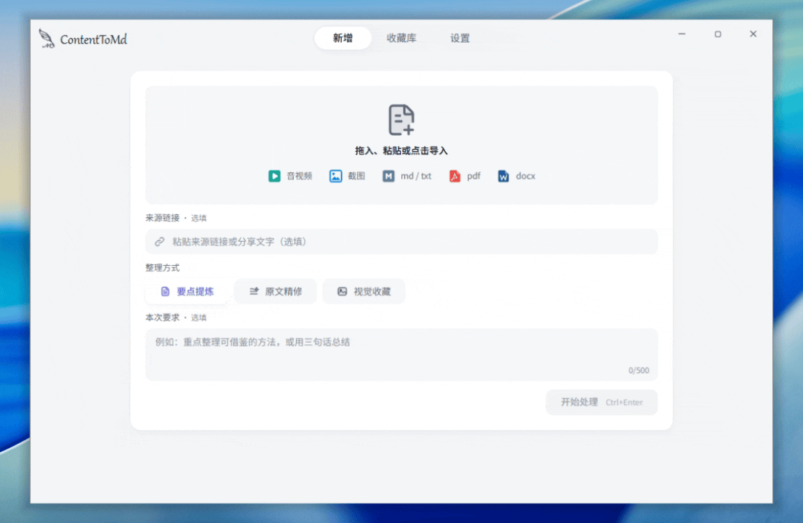
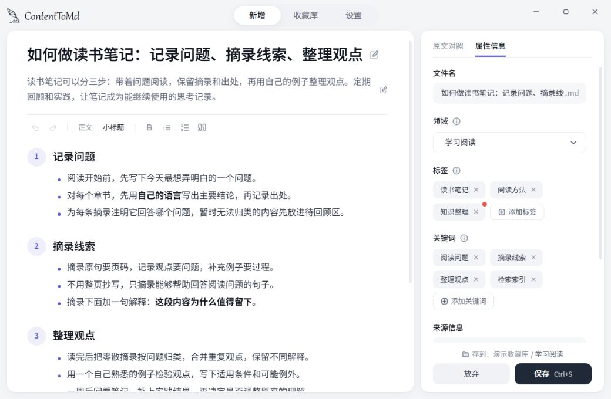

# ContentToMd

[简体中文](README.md) | English

**Stop letting saved content scatter. Turn what's worth keeping into your own knowledge base.**

ContentToMd is a Windows desktop tool that turns videos, audio, screenshots, and documents into Markdown notes, saved to Obsidian or a local folder.

Videos saved locally from Xiaohongshu or Douyin, screenshots, photos, downloaded documents: they end up scattered across apps and folders. You save a lot, but can't find it when you need it.

ContentToMd organizes all of it into Markdown notes. You review each note, file it under a domain, and save it to Obsidian or a folder of your choice. Saved content stops being something you "once kept" and becomes knowledge you can search, revisit, and build on.

> The app interface is currently in Simplified Chinese only.

## Why

People who like saving things rarely lack saved content. What's missing is the step that turns it into a knowledge base.

Platform bookmarks, phone albums, and local folders each hold a piece, with no single entry point. Moving things together by hand means summarizing, naming, and filing them yourself. The higher that cost, the faster saved content is forgotten.

ContentToMd shortens that distance: **drop scattered content in, let AI organize it, review it, and save it to one knowledge base.** Notes are plain Markdown files that work directly in Obsidian, where you can keep linking, searching, and building.

## Features

- **One entry point for many formats.** Video, audio, screenshots, text-based PDFs, Word (DOCX), and text files all go through the same window and come out as notes in a consistent format.
- **A knowledge base that grows its own structure.** Notes are filed by domain and can carry tags. When no domain fits, AI suggests a new one; it's created only if you approve.
- **Review before saving.** The source and the note sit side by side. Edit, then save, so everything in your library is something you've checked.
- **Works directly with Obsidian.** Notes are plain Markdown plus attachments. Save them into an Obsidian vault and keep linking, searching, and organizing. No ContentToMd account, no server of ours; your files stay yours.
- **Your own API keys, pay as you go.** The app is free. A short text note costs roughly one fen (about 0.1 US cent).

## How to use

1. **Install.** Download `ContentToMd_x.y.z_x64-setup.exe` from [Releases](https://github.com/chenyufengedu-dev/ContentToMd/releases) and run it (Windows 10/11 x64). This is an early test version.
2. **Set up.** Follow the onboarding to choose a library folder and enter AI keys. [DeepSeek](https://platform.deepseek.com/api_keys) handles text and images; [SiliconFlow](https://cloud.siliconflow.cn/account/ak) handles audio and video transcription: sign up → top up as needed → create and copy a key. Other compatible services can be configured in Settings.
3. **Organize.** Drag in, paste, or choose content; pick Key Points, Refined Transcript, or Visual Collection; review and save. Supports images, audio and video, MD/TXT, text-based PDFs, and DOCX.

## Data and privacy

When processing, the current content, your instructions, and your domain and tag names are sent to the AI service you configured. The text of your other notes is not sent. Keys are stored only in the local Windows Credential Manager.

Notes and attachments live in the library you choose; app settings are in `%APPDATA%\ContentToMd\`. Upgrading in place keeps your data. Uninstalling keeps your library and removes the app's own data and keys.

## FAQ

**Can it download videos from platforms?** No. Save the audio or video file locally first, then drag it in.

**Is there a Mac version?** Windows only for now.

**Windows says "Windows protected your PC" during install.** The app isn't code-signed yet. After checking where the installer came from, click "More info → Run anyway".

## Feedback

Report problems or suggestions via **Settings → About → Feedback**, or open a [GitHub Issue](https://github.com/chenyufengedu-dev/ContentToMd/issues). Include a screenshot and the app version; never include keys or private notes.

## License

Code is licensed under [MIT](LICENSE), by **Caraxes**. The bundled Noto Sans SC subset is licensed under [SIL OFL 1.1](src/assets/fonts/OFL.txt).
