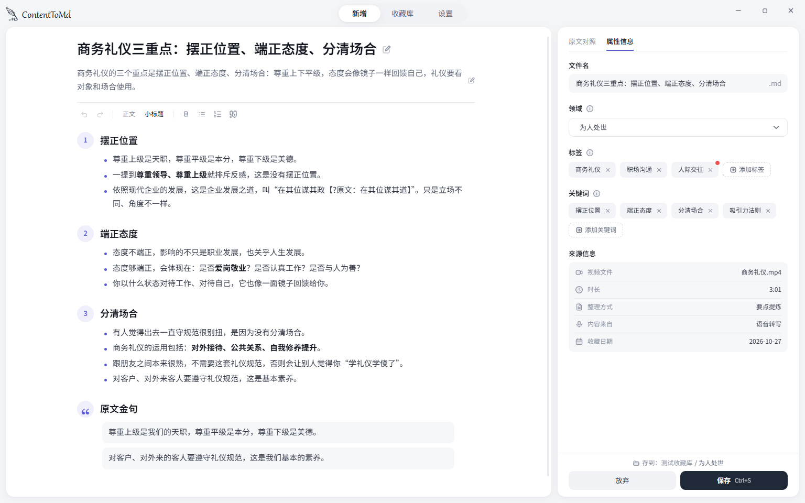

# ContentToMd

把视频、音频、截图和文档整理成 Markdown 笔记，存进普通文件夹或 Obsidian 仓库。整理后可以对照原文、修改，再保存；也可以在软件里浏览、搜索收藏。

目前是给朋友试用的 Windows 小工具，作者自用一周，同时收集朋友反馈。

## 安装和开始使用

运行作者发来的 `ContentToMd_版本号_x64-setup.exe`。软件目前没有代码签名；Windows 若提示“已保护你的电脑”，核对安装包来自作者后，点“更多信息 → 仍要运行”。本轮不提供自动更新，更新时覆盖安装即可。

第一次打开按引导选择收藏库、连接 AI，然后点“开始使用”。密钥可以暂时跳过，选好的收藏库会保留，收藏库仍会收到一篇简短欢迎笔记；进入首页后可点提示条的“去看看”打开它。

1. **文字和看图**：到 [DeepSeek 平台](https://platform.deepseek.com/api_keys) 注册登录，创建 API 密钥，复制到引导的 DeepSeek 密钥框。需要时在平台充值；推荐配置使用 `deepseek-flash`。
2. **音视频选填**：到 [硅基流动](https://cloud.siliconflow.cn/account/ak) 注册登录，创建 API 密钥，填入音视频转写配置。推荐模型为 `FunAudioLLM/SenseVoiceSmall`。不处理音视频可以先不填。

密钥不要发到群里或问题反馈中。粘贴密钥会自动测试连接，测试也会请求服务商接口，可能产生少量费用。

把文件拖进新增页、粘贴文字或截图，或点选文件。三种方式分别是：**要点提炼**抓重点，**原文精修**保留细节并修顺表达，**视觉收藏**记录图片的主体和视觉特点。

支持文字、MD/TXT、可提取文字的 PDF、DOCX、图片和 WebView2 能解码的音视频；扫描 PDF 暂不支持。图片每次最多 9 张、每张 20MB；MD/TXT 每份 10MB，PDF/DOCX 每份 50MB，音视频每份 1GB。要点提炼最多 10 万字，原文精修最多 5 万字。

## 费用与隐私

软件本身不收费，AI 服务由你的账户按用量付费。以 DeepSeek Flash 为例，按空闲时输入 1 元、输出 4 元/百万 tokens，输入 3000、输出 1000 tokens 约 **0.007 元**；高峰约 0.014 元。思考、重试、长文分段也计入用量，多图或长音视频整理可能更多。单价会变，以[服务商定价](https://api-docs.deepseek.com/zh-cn/quick_start/pricing/)和账单为准。

先在设置中填单价，保存成功页会显示本条估算费用，设置页可以看本月和累计费用；未填单价会显示价格未知。

转换时会把本次文字、压缩图片、音频、补充要求和已有标签名称发给所选服务商；不会发送其他笔记正文、文件夹结构或设备信息。设置页列有隐私说明。

## 文件存在哪里

- 笔记和附件：你选的收藏库；默认是 Windows“文档”下的“收藏库”。Obsidian 可选择仓库内的子文件夹。
- 配置、草稿、费用记录和自定义整理指令：`%APPDATA%\ContentToMd\`，分别为 `config.json`、`draft.json`、`usage.jsonl`、`prompts\` 等。
- API 密钥：Windows 凭据管理器里的 `ContentToMd` 项目。旧版配置首次加载时自动迁移，成功后移除配置中的明文。界面仍显示掩码。

## 常见问题与反馈

连接失败先检查密钥、余额和网络；扫描 PDF 请换成可选中文字的文档。收藏库找不到时，到设置里重新选择文件夹。软件需要 Windows 10/11 x64 和 WebView2 运行环境。

遇到问题或有建议，请打开 **设置 → 关于 → 反馈问题** 查看联系方式。请附操作步骤、截图、软件版本和 Windows 版本，别附密钥、私人笔记或完整配置文件。

卸载：在 Windows“设置 → 应用”中卸载 ContentToMd。卸载只删除软件，保留收藏库和配置；若不再使用，可自行删除 `%APPDATA%\ContentToMd\`，并在 Windows“凭据管理器 → Windows 凭据”中删除对应 `ContentToMd` 凭据。收藏库请自行备份保管。

## 许可

代码采用 [MIT](LICENSE)，作者 ChenyuFeng。内置思源黑体 Noto Sans SC 子集采用 [SIL OFL 1.1](src/assets/fonts/OFL.txt)；其他开源组件见软件设置页的“关于 → 开源致谢”。
