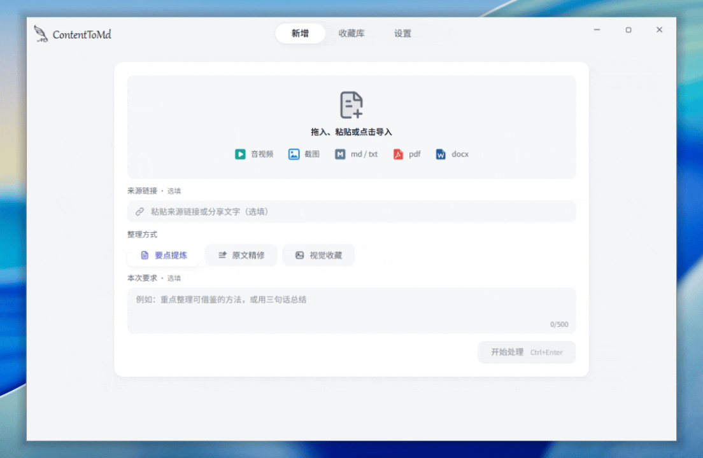
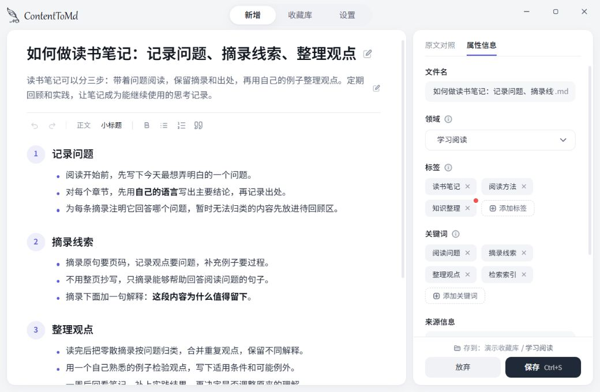

# ContentToMd

**收藏不再散落，让值得留下的内容进入自己的知识库。**

ContentToMd 是一个 Windows 桌面工具，把视频、音频、截图和文档整理成 Markdown 笔记，存进 Obsidian 或本地文件夹。

从小红书、抖音保存到本地的视频，随手截的图、拍的照片、下载的文档，常常散在不同平台和文件夹里。收藏了很多，真正需要时却找不到。

ContentToMd 把这些内容统一整理成 Markdown 笔记，核对后按领域归档，存进 Obsidian 或自己选择的文件夹。让收藏不只停在“存过”，而是成为可以查找、回看和继续积累的知识。

## 为什么做它

喜欢保存内容的人，往往不缺收藏，缺的是把收藏变成知识库的那一步。

平台收藏夹、手机相册、本地文件夹各存一份，没有统一入口；手动搬到一起，还要自己提炼、命名、分类。整理成本越高，存下来的内容就越容易被遗忘。

ContentToMd 想缩短这段距离：**把散落的内容放进来，让 AI 帮忙整理，核对后存进同一个知识库。** 笔记是普通 Markdown 文件，可以直接接入 Obsidian，继续链接、搜索和积累，让外界的信息逐渐沉淀为自己的知识。

## 有什么不同

- **一个入口，收多种内容。** 视频、音频、截图、可提取文字的 PDF、Word（DOCX）和文本，都能从同一个窗口导入，整理成统一格式的笔记。
- **知识库会自己长结构。** 笔记按领域归档，也能添加标签；没有合适的领域时，AI 会建议新领域，你点头才创建。
- **核对后才入库。** 原文和笔记并排，改好再存，库里留下的是你确认过的东西。
- **直接接上 Obsidian。** 笔记是普通 Markdown 加附件，存进 Obsidian 库就能用，可以继续链接、搜索、整理。不用注册 ContentToMd 账号，软件没有自己的服务器，文件永远是你的。
- **用自己的密钥，按量付费。** 软件免费，少量文字整理大约一条一分钱。

## 怎么用

1. **安装。** 运行 Windows 10/11 x64 安装包，安装包暂由作者提供。
2. **配置。** 跟随引导选择收藏库、填写 AI 密钥。[DeepSeek](https://platform.deepseek.com/api_keys) 用于文字和看图，[硅基流动](https://cloud.siliconflow.cn/account/ak) 用于音视频转写：注册登录 → 按需充值 → 创建并复制密钥。也可在设置中配置其他兼容服务。
3. **整理。** 拖入、粘贴或选择内容，选用要点提炼、原文精修或视觉收藏，检查后保存。支持图片、音视频、MD/TXT、可提取文字的 PDF 和 DOCX。

## 数据与隐私

处理时，本次内容、整理要求和领域、标签名称会发给你配置的 AI 服务；不发送其他笔记正文。密钥只保存在本机 Windows 凭据管理器中。

笔记和附件在你选择的收藏库，软件配置在 `%APPDATA%\ContentToMd\`。覆盖升级保留数据；卸载时保留收藏库，清除软件自身数据和密钥。

## 常见问题

**能直接下载平台视频吗？** 不能。请先准备本地音视频文件，再拖入软件。

**有 Mac 版吗？** 目前只提供 Windows 版。

**安装时提示“已保护你的电脑”怎么办？** 软件尚未签名。核对安装包来源后，点“更多信息 → 仍要运行”。

## 反馈

遇到问题或有建议，请通过 **设置 → 关于 → 反馈问题**，或提交 [GitHub Issue](https://github.com/chenyufengedu-dev/ContentToMd/issues)。请附截图和软件版本，不要附密钥或私人笔记。

## English

ContentToMd is a Windows desktop tool that turns saved content into Markdown notes.
It supports local video and audio files, screenshots, text-based PDFs, DOCX documents, and Markdown or plain text files.
Review and edit the generated notes alongside the source before saving them.
Save notes and attachments directly to an Obsidian vault or a local folder.
Use your own API keys for compatible AI services, with usage billed by your provider.

## 许可证

代码采用 [MIT](LICENSE)，作者 **Caraxes**；内置思源黑体子集采用 [SIL OFL 1.1](src/assets/fonts/OFL.txt)。
